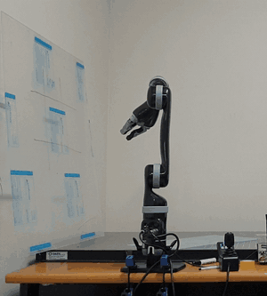

# EMG-Based Hand Motion Recognition and Robot Arm Control

MATLAB scripts and Arduino firmware from Do-Gyeong Yuk's M.S. research on recognizing hand and forearm motions from surface electromyogram (EMG) signals and using the recognized motion to command a Kinova robot arm.
The code covers three sensing set-ups (a custom Arduino EMG/IMU band, a Myo armband, and analog EMG read through an NI data-acquisition device), threshold-based segmentation with windowed features, neural-network and k-nearest-neighbour classifiers, and multi-subject (user-independent) experiments.

  
   
  The robot arm following recognized forearm motions (cropped to the arm, 7x speed).

## Publications

- D.-G. Yuk, J. W. Sohn, "User Independent Hand Motion Recognition for Robot Arm Manipulation," J. Mech. Sci. Technol., 36(6), 2739–2747, 2022. https://doi.org/10.1007/s12206-022-0507-x
- D.-G. Yuk, J. W. Sohn, "Hand Gesture Recognition Using Surface Electromyogram," Trans. Korean Soc. Noise Vib. Eng., 28(6), 670–676, 2018. https://doi.org/10.5050/ksnve.2018.28.6.670
- D.-G. Yuk, "Motion Recognition and Robot Control Using Electromyogram" (M.S. thesis, in Korean), Kumoh National Institute of Technology, 2020.
- Conference: PRESM 2018, PRESM 2019, PRESM 2020.

## Repository structure

| Path | Purpose |
|---|---|
| `firmware/EMG_GYRO_Pa/REV_1.0/` | Arduino sketch that streams analog EMG voltages and an IMU quaternion over USB serial. |
| `firmware/BT/` | Arduino sketch that streams EMG voltages and an IMU quaternion over a Bluetooth serial module. |
| `firmware/BT_gyro/` | Arduino sketch that streams rectified EMG counts with IMU acceleration and angular rate over Bluetooth. |
| `matlab/acquisition/` | Trial collectors for the Arduino band over serial (`collecter3ch.m`, `collecter4ch.m`, `collecterREV_1_1.m`) and Bluetooth (`CollecterV1_3.m`, `BTcode.m`), the Myo armband (`EmgRawDataCollector.m`) and the NI DAQ device (`test_collect_code.m`). |
| `matlab/recognition/arduino_band/` | Feature and target assembly (`sigg*.m`, `DownSample*.m`) and online classification tests (`pTest*.m`, `ptest3ch.m`, `Signtest.m`) for the serial Arduino band. |
| `matlab/recognition/bluetooth_band_rps/` | Rock-scissors-paper experiment with the Bluetooth band: data assembly (`testneuralmaker.m`), KNN table and test (`Untitled2.m`), online test (`first_Testing.m`). |
| `matlab/recognition/myo/` | Myo pipeline: trial segmentation (`processing.m`), input/target assembly (`NeuralMaker.m`), online recognition (`emg_test_neural2.m`). |
| `matlab/robot_control/` | Online control of the Kinova arm from Myo EMG plus two IMUs (`myo_test_neural_imu_jaco_fin.m`), from DAQ EMG plus two IMUs (`AI_jaco_test_code.m`), gripper only (`AI_jacogripper_code.m`) and IMUs only (`imu_jaco_test_fin.m`); IMU serial callbacks (`mycallback.m`, `mycallback2.m`); joint and finger command/feedback tests (`motor6movingcode.m`, `gripper_feedback_plot.m`); LEGO EV3 motor control from Myo EMG (`emg_test_Lego.m`, `LEGO.m`). |
| `matlab/user_independent/myo_multi_subject/` | Multi-subject Myo experiments: network input assembly (`ANNData.m`), KNN table assembly, training and tests (`KNNDataMaker_rev.m`, `KNN.m`, `TestForKNNCode.m`, `KNNAccuracyTest.m`), online KNN recognition (`emg_test_neural3.m`). |
| `matlab/user_independent/daq_3ch/` | Online recognition with three DAQ channels and amplitude normalization (`AI_testing_code_3ch.m`). |
| `archive/usb_prototype_2017-06/` | First offline segmentation script for six recorded channels. |
| `archive/daq_4ch_2019-07/` | Earlier four-channel DAQ prototype: collector, reshaping and online test. |
| `archive/myo_jaco_2019-05/` | Earlier Myo-to-arm script in which a gesture triggers a transfer of the IMU pose change to the arm. |
| `docs/emg_robot_arm_demo.gif` | Short clip of the arm during an online recognition run. |

## How it works

- Acquisition with the Arduino band: a collector records a short baseline, waits until a channel leaves the baseline by a fixed threshold, and then stores a fixed number of samples as one trial.
- Acquisition with the Myo armband: the collector records a continuous MAV stream, and `processing.m` cuts it into trials wherever the stream exceeds a threshold.
- Acquisition with the NI DAQ device: a capture is started when a single scan exceeds a threshold.
- Features with the Arduino band: the scripts concatenate the channels of a trial and block-average them to a fixed-length vector.
- Features with the Myo armband: the scripts compute the mean absolute value (MAV) over a sliding window and stack consecutive MAV rows of all channels.
- Features with the NI DAQ device: the scripts compute a moving root mean square (RMS), cut a fixed segment near the peak and divide it by its maximum.
- Classification with neural networks: the assembled input and one-hot target matrices are used to train pattern-recognition networks in MATLAB, and the online scripts call the exported network functions by name.
- Classification with KNN: `KNN.m` is the training function exported from the Classification Learner app, and the test scripts call `predictFcn` of stored model structs.
- Robot control: the recognized class index selects a row of a joint-increment table and a finger scaling factor, which are sent to the arm through the `JacoComm` class.
- Arm teleoperation: two IMU streams are read by serial callbacks, and angle changes above a threshold are added to the first three joints of the home pose.
- User independence: the multi-subject scripts pool trials of several subject codes per gesture, and the DAQ scripts normalize each trial by its maximum before classification.

### Sensing set-ups as coded

| Set-up | Values per sample | Timing in code | Feature vector | Classes | Evidence |
|---|---|---|---|---|---|
| Arduino band, USB serial | 8 analog inputs + 4 quaternion values in the sketch; the MATLAB scripts read 6, 8, 10 or 12 columns | 115200 baud, `delay(20)` per loop, 20 samples per trial | block-averaged to 40 values | 3 (WAVE OUT, WAVE IN, FIST) and 9 sign-language words | `REV_1.0.ino`, `collecter4ch.m`, `sigg4ch.m`, `pTest4ch.m`, `DownSample.m`, `Signtest.m` |
| Arduino band, Bluetooth | 6 analog inputs + 4 quaternion values, or 6 analog inputs + 3 acceleration + 3 angular-rate values | 57600 baud, `delay(5)` per loop | 50 samples x 12 columns = 600 values | 5 (rock, scissors, paper, start, finish) | `BT.ino`, `BT_gyro.ino`, `BTcode.m`, `first_Testing.m` |
| Myo armband | 8 EMG channels | sampling rate not stated in the code | MAV over a 40-sample window; 50 rows x 8 channels = 400 values, or 200 rows x 8 channels = 1600 values | 4 to 6 gestures depending on the script | `EmgRawDataCollector.m`, `processing.m`, `emg_test_neural2.m`, `emg_test_neural3.m` |
| NI DAQ analog input | 3 channels (`ai0`-`ai2`) | 2000 Hz, 1 s capture | moving RMS over 200 samples; 400 samples x 3 channels = 1200 values, divided by the maximum | 4 (Hold Fist, Stretch, Hand Out, Hand In) | `AI_testing_code_3ch.m`, `AI_jaco_test_code.m` |
| IMUs for arm teleoperation | 2 serial streams; columns 3 and 4 of each line are used as angles in degrees | 921600 baud | not used as a classifier input | none | `myo_test_neural_imu_jaco_fin.m`, `mycallback.m`, `mycallback2.m` |

### Robot commands as coded

| Script | Class or event | Command |
|---|---|---|
| `myo_test_neural_imu_jaco_fin.m` | Hold Fist | finger position command multiplied by 6000 (close) |
| `myo_test_neural_imu_jaco_fin.m` | Stretch | finger position command multiplied by 1/6000 (open) |
| `myo_test_neural_imu_jaco_fin.m` | Hand In / Hand Out | joint 6 moved by +0.5 / -0.5 rad |
| `myo_test_neural_imu_jaco_fin.m` | IMU angle change above 0.174 rad | joints 1 to 3 set to the home pose plus the IMU angle changes |
| `AI_jaco_test_code.m` | Hand Out / Hand In | joint 6 moved by -1 / +1 rad |
| `AI_jacogripper_code.m` | Hold Fist / Stretch | finger position command only |
| `emg_test_Lego.m` | 6 classes | one row of a speed table for 4 EV3 motors |

### Multi-subject scripts as coded

| Script | Content |
|---|---|
| `ANNData.m` | training matrix 1600 x 3600 (6 subject codes x 6 gestures x 100 trials) and test matrix 1600 x 720 |
| `KNNDataMaker_rev.m` | table of 1728 rows x 800 features with 6 classes of 288 rows |
| `KNN.m` | `fitcknn` with Euclidean distance, 5 neighbours, standardized predictors, 1600 predictors, 6 classes and 5-fold cross-validation |
| `TestForKNNCode.m` | predictions of 15 stored KNN model structs (`cos*`, `che*`, `Che*` with suffixes 1, 3, 5, 7, 9) |
| `emg_test_neural3.m` | online KNN prediction for 6 gestures (Hold Fist, Hold Stretch, Hand Out, Hand In, Fist Out, Fist In) |

## Requirements

- MATLAB; `KNN.m` states that it was exported from Classification Learner R2017a.
- Instrument Control Toolbox functions (`Bluetooth`, `instrfindall`) and `serial` objects for the Arduino band and the IMUs.
- Data Acquisition Toolbox with an NI device addressed as `Dev1` (`daq.createSession('ni')`).
- Statistics and Machine Learning Toolbox (`fitcknn`, `crossval`, `kfoldPredict`).
- Neural-network functions exported from MATLAB's Neural Network Toolbox with `genFunction`, which the online scripts call by name and which are not included.
- Curve Fitting Toolbox function `smooth` for `archive/usb_prototype_2017-06/final_20170612.m`.
- MATLAB Support Package for LEGO MINDSTORMS EV3 Hardware (`legoev3`, `motor`) for the LEGO scripts.
- The `JacoComm` class of the third-party `matlab_Kinovaapi_wrapper` project (JACO2 Communicator, Copyright 2017 The MathWorks, Inc.) with the Kinova SDK libraries, which is not included.
- Myo Connect and a `getMyoEmg.exe` helper that writes `emg.txt`, started with Windows `start` and `taskkill` commands, which are not included.
- Arduino libraries `Wire.h` and `SoftwareSerial.h`, an I2C IMU addressed through `MYAHRS_I2C_ADDRESS` in the sketches, and a Bluetooth serial module (an HC-05 is named in `first_Testing.m`).
- Two serial IMU receivers for the arm teleoperation scripts; the IMU model is not named in the code.

## Running

- Upload one sketch from `firmware/` to the Arduino and run the matching collector in `matlab/acquisition/` to record trials into workspace arrays.
- Run the assembly scripts in `matlab/recognition/` or `matlab/user_independent/` on those arrays to build input and target matrices, then train a classifier.
- Run an online script after placing the trained classifier function or model struct on the MATLAB path or in the workspace.
- Run the robot scripts from a folder in which `JacoComm` and the Kinova SDK libraries are available.
- The scripts are workspace-driven, so many of them expect variables from earlier steps and use hard-coded COM port and Bluetooth device names.

## Data

- No EMG recordings are included, because they were recorded from the author and other participants.
- No trained classifiers are included, neither the exported network functions nor the stored KNN model structs.
- The dataset-assembly scripts (`sigg*.m`, `DownSample*.m`, `testneuralmaker.m`, `processing.m`, `NeuralMaker.m`, `ANNData.m`, `KNNDataMaker_rev.m`) therefore need recordings made with the collectors.
- The code does not name any public dataset.

| Script | Classifier or model it calls (not included) | Other external dependency |
|---|---|---|
| `pTest.m`, `pTest4ch.m` | `pattern4ch_1` | Arduino band |
| `ptest3ch.m` | `pattern3ch_1` | Arduino band |
| `Signtest.m` | `Pattern9` | Arduino band |
| `first_Testing.m` | `RSP_9` | Bluetooth band |
| `Untitled2.m` | KNN structs `euc40_*`, `euc60_*`, `euc80_*` | recorded arrays |
| `emg_test_neural2.m` | `trainedNet` (placeholder name) | Myo helper |
| `emg_test_neural3.m` | KNN struct `KNNC` | Myo helper |
| `TestForKNNCode.m`, `KNNAccuracyTest.m` | KNN structs `cos*`, `che*`, `Che*`, `KNNA` | recorded arrays |
| `AI_testing_code_3ch.m` | `after` | NI DAQ |
| `myo_test_neural_imu_jaco_fin.m` | `trainedNet` (placeholder name) | Myo helper, IMUs, `JacoComm` |
| `AI_jaco_test_code.m` | `dg_hsho` | NI DAQ, IMUs, `JacoComm` |
| `AI_jacogripper_code.m` | `noraxon` | NI DAQ, `JacoComm` |
| `imu_jaco_test_fin.m` | none | IMUs, `JacoComm` |
| `motor6movingcode.m`, `gripper_feedback_plot.m` | none | `JacoComm` |
| `emg_test_Lego.m` | `myNeuralNetworkFunction_10_710` | Myo helper, LEGO EV3 |
| `archive/daq_4ch_2019-07/testingcod.m` | `testtesttest` | NI DAQ |
| `archive/myo_jaco_2019-05/emg_test_neural_jaco4.m` | `four2` | Myo helper, IMUs, `JacoComm` |

## Notes

- This is research code kept as it was used, with file modification dates from June 2017 to February 2023.
- File names are the original ones, including working names such as `Untitled2.m`.
- Some comments are in Korean; files originally stored in CP949 were converted to UTF-8.
- In two scripts the call to a trained-network function was renamed to the placeholder `trainedNet`, and two comments naming participants were shortened; no other code was changed.
- The I2C register map and read/write helpers in the firmware come from the IMU vendor's SDK example, as the comments in the sketches state.
- The Myo scripts are built on a script whose header reads "Pseudo-real-time EMG data extraction from Myo to MATLAB".
- `archive/` holds earlier variants that document a different sensing or control scheme.
